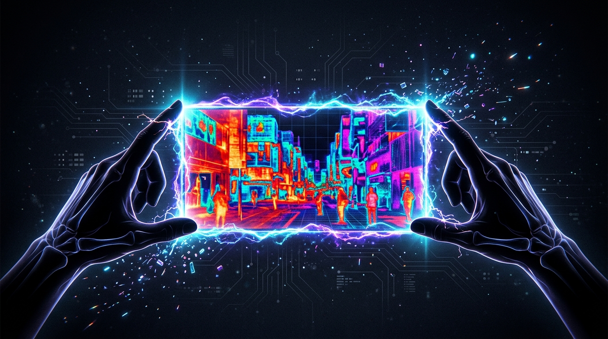
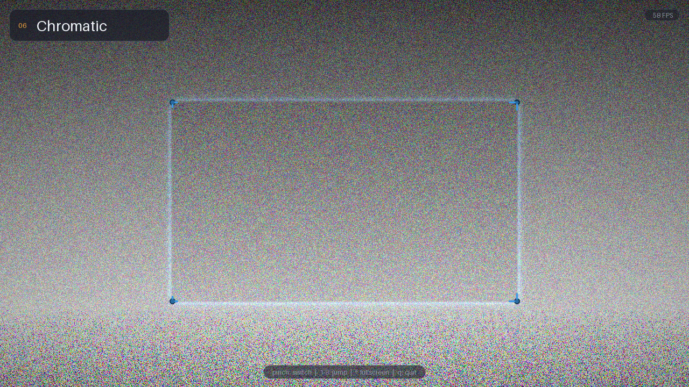

<p align="center">
  
</p>

<h1 align="center">🖐️ HandPortal</h1>

<p align="center">
  <b>Stretch a portal between your fingertips — reality gets a different skin inside.</b>
</p>

<p align="center">
  
  
  
  
</p>

<br/>

<p align="center">
  
  <br/>
  <sub>Chromatic aberration effect active — portal stretched between two index fingertips</sub>
</p>

---

## ✨ What is this?

**HandPortal** is a real-time computer vision toy that turns your webcam feed into a sci-fi portal window. Hold up both hands, and an **energy-rimmed portal** stretches between your index fingertips. Everything inside the portal is replaced with a processed version of itself — thermal vision, edge meshes, neon posterization, glitch art, and more.

**Pinch your thumb and index finger** on either hand to cycle through effects. It's that simple.

No external hardware. No depth sensor. Just a webcam and your hands.

---

## 🎨 Effects

| # | Effect | Description |
|---|--------|-------------|
| 1 | **Thermal** | Classic infrared heat-map colorization |
| 2 | **Edge Mesh** | Canny edge detection on a dark void — wireframe reality |
| 3 | **Posterize Neon** | Quantized color bands with cranked saturation |
| 4 | **Invert Glitch** | Inverted colors with per-channel shift for a data-corruption look |
| 5 | **Sketch** | Pencil-drawing dodge-burn technique |
| 6 | **Chromatic** | RGB channel separation — cinematic lens aberration |
| 7 | **Pixel Mosaic** | Chunky pixel-art downscale with visible block seams |
| 8 | **Duotone** | Luminance mapped onto a deep-indigo → electric-cyan ramp |

---

## 🚀 Getting Started

### Prerequisites

- **Python 3.9+**
- A working **webcam**

### Installation

```bash
# Clone the repo
git clone https://github.com/<your-username>/handportal.git
cd handportal

# Install dependencies
pip install -r requirements.txt

# Run it
python portal_app.py
```

> [!NOTE]
> On first launch, the MediaPipe hand landmark model (~7 MB) is automatically downloaded. No manual setup needed.

---

## 🎮 Controls

| Key | Action |
|-----|--------|
| **Pinch** (thumb + index, either hand) | Cycle to next effect |
| `1` – `8` | Jump directly to a specific effect |
| `f` | Toggle fullscreen |
| `s` | Save screenshot |
| `d` | Toggle downscaled detection (faster, slightly less accurate) |
| `v` | Toggle cinematic vignette |
| `+` / `-` | Adjust pinch sensitivity |
| `q` | Quit |

---

## 🏗️ How It Works

<details>
<summary><b>Architecture at a glance</b></summary>

<br/>

```
Webcam → MediaPipe Hand Landmarker (2 hands, 21 landmarks each)
                    │
                    ├─ Index fingertips → axis-aligned bounding box (the "portal")
                    │       └─ Crop region → apply effect UNDISTORTED → feathered mask composite
                    │
                    └─ Thumb + index distance → edge-triggered pinch detector
                            └─ armed/disarmed state machine (no cooldown timer)
```

**Key design rules:**
- **No perspective warping** — the effect content is never distorted. The bounding region is cropped, processed straight, pasted back, then clipped to the portal shape.
- **Pinch detection is architecturally separate** from portal rendering — it reads raw landmarks directly with an edge-triggered state machine (fires once per pinch gesture, hold as long as you want).
- Portal edges are **feathered with a Gaussian blur** for soft blending instead of a hard cutout.
- **Exponential moving average** smooths the quad position across frames, eliminating jitter.
- Portal materializes with a **fade-in + scale-in** animation; effect switches use a **crossfade** transition.

</details>

### Visual Polish

- 🔮 **Pulsing rim glow** — soft additive bloom with a cyan ↔ violet color cycle
- 📐 **Corner bracket accents** — AR-style corner indicators with per-corner shimmer
- ✨ **Energy particles** — spawn from portal corners, drift outward with drag
- 🎬 **Cinematic vignette** — radial darkening (toggle with `v`)
- 🖥️ **Designed HUD** — PIL-rendered panels with rounded corners, slide-in label animation, FPS pill, and a fade-out controls hint

---

## 📦 Project Structure

```
handportal/
├── portal_app.py       # Everything — effects, detection, rendering, HUD, main loop
├── requirements.txt    # Python dependencies
├── preview.png         # Screenshot
├── assets/
│   ├── banner.jpg      # README hero image
│   └── preview.png     # Screenshot copy
└── .gitignore
```

> The hand landmark model (`hand_landmarker.task`, ~7 MB) is downloaded automatically on first run and excluded from git.

---

## ⚙️ Configuration

All tunable parameters are at the top of `portal_app.py`:

| Parameter | Default | Description |
|-----------|---------|-------------|
| `CAM_INDEX` | `0` | Camera device index |
| `FRAME_W` / `FRAME_H` | `1280×720` | Requested camera resolution |
| `PINCH_DIST_THRESHOLD` | `0.06` | Normalized landmark distance for pinch detection |
| `FULLSCREEN` | `True` | Start in fullscreen mode |
| `DETECT_DOWNSCALE` | `False` | Half-resolution detection for performance |
| `VIGNETTE` | `True` | Cinematic vignette overlay |

---

## 🤝 Contributing

Pull requests are welcome! Some ideas:

- 🎨 **New effects** — add your own `fx_*` function and append it to `EFFECTS` / `EFFECT_NAMES`
- 🎯 **Gesture controls** — map new hand gestures to actions
- 📱 **Mobile support** — port to a web-based solution with MediaPipe JS
- 🎥 **Video recording** — capture the portal output as a video file

---

## 📄 License

This project is licensed under the [MIT License](LICENSE).

---

<p align="center">
  <sub>Built with OpenCV, MediaPipe, and way too much fun 🎉</sub>
</p>
